# How Bones uses AI

Bones is the talking head on the wall at our Halloween party. Guests say
"Hello, Bones," and it introduces itself, sizes up their costume, tells jokes,
and gives directions to the bathroom. None of that is scripted: it is
several AI models working together, each doing one job.

This page explains which models there are, where each one runs, what
information goes where, how long things take, and what it costs. It is written
for someone who manages technical work but doesn't write the code.

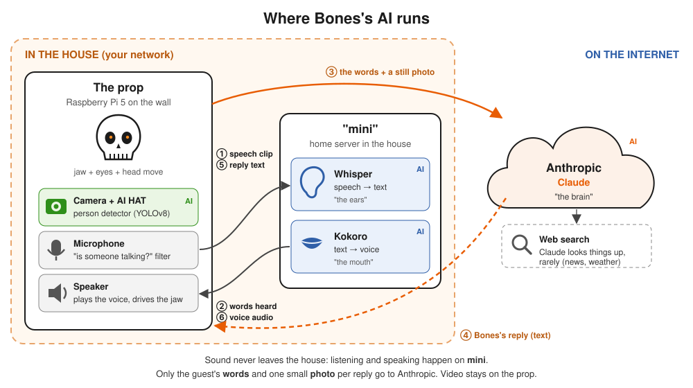

## The cast: every AI model involved

| Job | Model | Where it runs | Size | Cost to run |
|---|---|---|---|---|
| **See** whether someone is standing there | **YOLOv8s** person detector | AI HAT (a Hailo-8L AI chip) on the Pi | ~11 million parameters | Free (own hardware) |
| **Notice** that someone close by is talking | **WebRTC voice detector** plus a loudness gate | The Pi's processor | Tiny (not a neural network) | Free |
| **Hear**: turn speech into text | **Whisper** (distil small.en) | "mini", a server in the house | ~166 million parameters | Free (own hardware) |
| **Think**: decide what to say | **Claude Sonnet 5.5**, by Anthropic | Anthropic's cloud | Very large (not published) | About 1¢ per reply |
| **Look things up**, rarely | Claude's **web search** tool | Anthropic's cloud | (part of Claude) | Small fee per search |
| **Speak**: turn text into a voice | **Kokoro-82M**, voice "bm_george" | mini | 82 million parameters | Free (own hardware) |
| *Backup ears* if mini is down | Whisper small.en | The Pi | ~244 million parameters | Free |
| *Backup voice* if mini is down | Piper ("lessac" voice) | The Pi | Small | Free |

"Parameters" are roughly a model's size. A bigger model is usually smarter but
slower and needs more hardware. Everything except Claude is small enough to run
on hardware in the house. Claude is the one part we rent.

## The three places things run

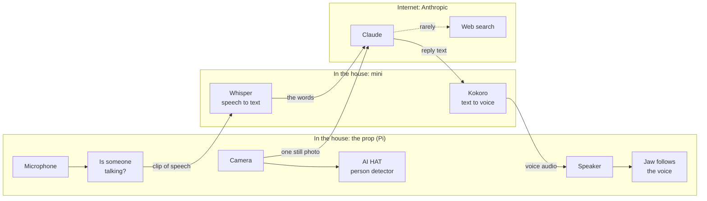

Strictly speaking every arrow goes through the Pi, which runs the show. For
example, Whisper hands the words back to the Pi, and the Pi sends them to
Claude. The diagram skips that to show the path the *information* takes.

Why split it up this way?

- **The camera and microphone have to be on the prop**, and the AI HAT can
  check every video frame for people without slowing the Pi down.
- **Speech models need more computer than the Pi has.** On mini, turning a
  sentence into text takes about 1 second. On the Pi alone it takes about 7.
- **Only Claude is good enough at conversation**, and it only runs in
  Anthropic's data centers. Keeping sound and video in the house means only
  text and the occasional photo leave it.

## A conversation, step by step

Here is what happens when a guest walks up and talks to Bones:

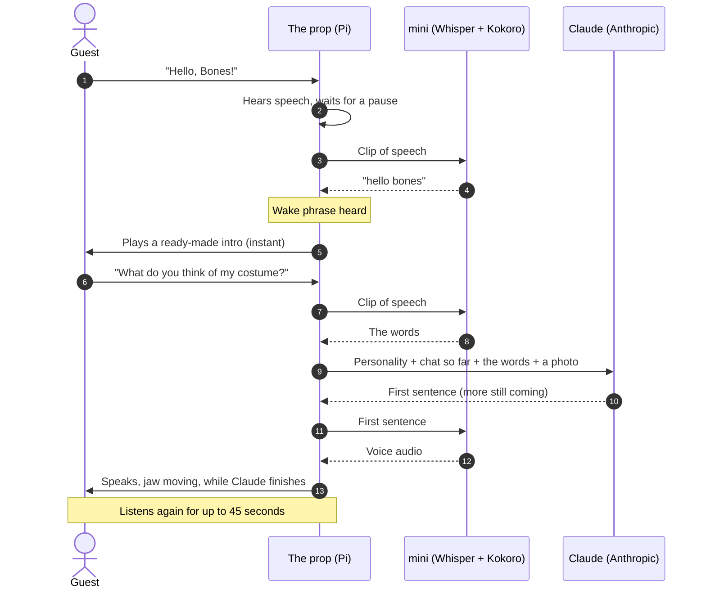

The trick that keeps this tolerable is **streaming**. Bones doesn't wait for
Claude's whole answer. As soon as the first sentence is written, it is voiced
and played while Claude is still writing the second. The guest hears the
start of the reply instead of waiting for all of it.

### Where the seconds go

Measured from the bot's own logs, Oct 24–28 (the middle value, and the slow
end at the 90th percentile):

| Step | Typical | Slow | Notes |
|---|---|---|---|
| Notice the guest stopped talking | 0.7 s | 0.7 s | Waits for 0.7 s of silence, so it doesn't cut people off |
| Whisper: speech to text (mini) | 1.1 s | 1.8 s | Over ~5,200 clips |
| Claude: first words of the reply | 1.7–6 s | 7–8 s | The most variable step (see below) |
| Kokoro: first sentence voiced (mini) | 1.1 s | 2.0 s | Over 350 sentences |
| **Total, end of question to first word** | **about 4–9 s** | **10+ s** | That's why the sign says "be patient" |

Claude is the slowest and least predictable step. Most of the replies logged
before Oct 27 took about 6 seconds to start, while a benchmark in quieter
conditions measured about 1 second. The handful since then have been closer to
1.7 seconds. Introductions, jokes and the house questions (bathroom, Ken,
Amy) are **prepared in advance** (see below), so they skip Claude and Kokoro
entirely and start immediately.

## 1. Seeing: the camera and the AI HAT

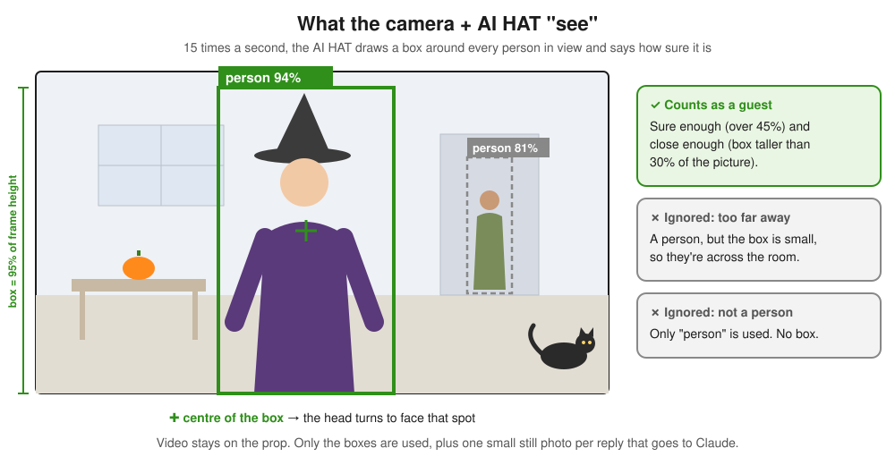

- The camera feeds a small copy of each frame straight to the **AI HAT**, a
  plug-in board with a dedicated AI chip. The chip runs **YOLOv8**, a
  well-known object detector. It recognises 80 kinds of everyday things, but
  Bones only pays attention to **"person"**.
- It runs at the camera's speed, **15 frames a second**, and the Pi's own
  processor barely notices (about 13% of one of its four cores).
- A person **counts** when the detector is at least 45% sure *and* their box is
  taller than 30% of the picture. The second rule is how "close enough to
  talk to" is measured: someone across the room is still a person, just a
  small one.
- To avoid flickering decisions, someone has to be seen in **6 frames in a row**
  to "arrive" and missing for **25 frames** (under 2 seconds) to "leave".
- **What it's used for:** turning the head to face the guest, and the costume
  photo. Each time a guest speaks, the Pi saves one still picture (640×360,
  about 30 KB) and sends it to Claude with their words. That's how Bones can
  comment on a costume.

**Video never leaves the prop.** For checking the camera there's a live view
with the boxes drawn on (`make view`), but it only works from a computer that
logs into the Pi; it isn't published on the network.

## 2. Hearing: knowing when someone is talking

A party is noisy, and the hard part isn't understanding speech, it's deciding
*which* speech is meant for Bones.

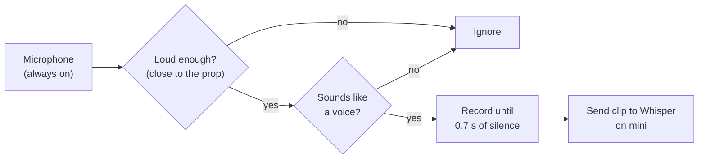

- **Loudness first.** Volume falls off quickly with distance, so a loudness
  threshold is what separates the guest leaning in from the crowd behind them.
  It's tuned at real party volume.
- **Then "is it a voice?"** A small, classic detector (built into Google's
  WebRTC, which video-call apps use) separates speech from music and clatter.
- **Bones never hears itself.** The microphone is muted while Bones is
  talking, plus a quarter second for the echo to die down, so it can't
  answer its own voice.

## 3. "Hello, Bones": the wake phrase

Bones stays quiet until someone says its name, the way a smart speaker
waits for "Alexa".

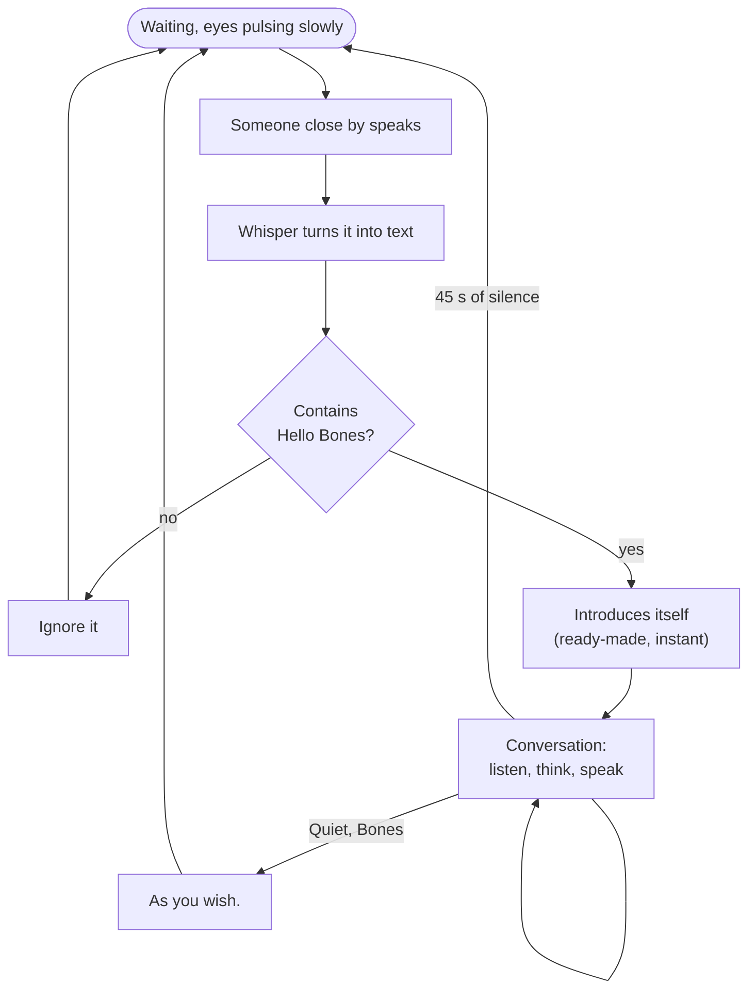

- Whisper sometimes mishears the name, so close variants like "Hallo Bones" and
  "Hello Bone" count too.
- **Every snippet of nearby speech gets transcribed** to check for the
  phrase. From Oct 24 to 28 that was about **5,100 snippets ignored for 22 real
  wake-ups**. This happens on mini, inside the house, not in the cloud. See
  [Privacy](#privacy-what-leaves-the-house) for what is kept.
- In wake-phrase mode the camera doesn't *start* conversations; it still
  steers the head and supplies the costume photo. Bones can also be switched to
  greet anyone who walks up, using the camera, with no wake phrase needed.

## 4. Thinking: Claude

Claude is the only part that is actually "smart", and the only paid part.
Every time a guest says something, the Pi sends Claude a package:

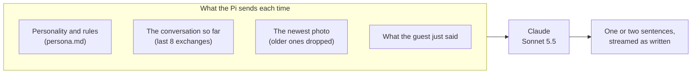

- **The personality** lives in a plain-text file, `persona.md`. It tells Claude
  who Bones is (a dry, theatrical spirit bolted to the wall since 1874), how to
  talk (one or two sentences, no stage directions), and the house facts
  ("Where's the bathroom?", "Where are Ken and Amy?"). Changing Bones's
  personality means editing that file, not the code.
- **The rules** in the same file: keep it PG-13 because children talk to
  it; comment on costumes, never on bodies or faces; never claim to know who
  someone is; never admit to being an AI; and if someone is genuinely upset,
  drop the act and point them to a real person.
- **Memory is short on purpose.** Claude itself remembers nothing between
  calls. The Pi resends the recent conversation each time, and forgets it when
  the conversation ends. The one exception: the last 5 greetings are kept, so
  Bones can notice "I've seen that costume already tonight."
- **Tuned for speed**, not depth. Claude's slower step-by-step reasoning mode
  is turned off, and replies are kept short.

### Why this model

We tested four Claude models from the Pi with the real personality, 18 calls
each, timing how long until the first full sentence:

| Model | First sentence | Verdict |
|---|---|---|
| Claude Haiku 4.5 | 0.8 s | Fastest, but flatter jokes, and slipped spoken "*stage directions*" into replies |
| **Claude Sonnet 5.5** | **1.0 s** | **Chosen.** Funniest of the fast ones, clean output |
| Claude Sonnet 5 | 1.2 s | Good, but long single sentences, so the voice can't start early |
| Claude Opus 5.5 | 1.9 s | Funny, too slow for a party |

### Web search

Claude can look things up, for questions it couldn't otherwise answer:
tonight's game score, the weather, or what an obscure costume is from.
Anthropic's servers run the search, not our network. It's limited to one
search per reply, Bones says a line in character first ("Let me consult the
oracle") so the silence makes sense, and the rules say that web pages are
information, never instructions. In practice it's rare: so far, one search in total.

## 5. Speaking: the voice, jaw and eyes

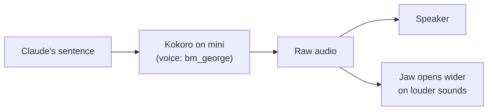

- **Kokoro** is a small, open text-to-speech model. It voices a sentence about
  three to four times faster than it takes to say it.
- **The jaw isn't AI.** It simply follows the loudness of the audio as it
  plays, which is why it stays in sync.
- **The eyes show what Bones is doing**, so guests know whether to wait:

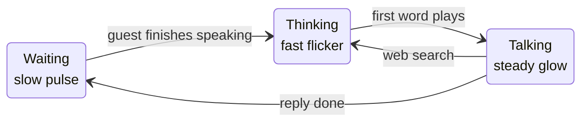

## 6. Getting ahead: ready-made answers

The most common requests don't need a fresh trip to Claude, so Bones prepares
them in advance:

| Request | Ready-made answers | Plays when a guest… |
|---|---|---|
| "Hello, Bones" | 5 introductions | says the wake phrase |
| "Tell me a joke" | 5 jokes | mentions a joke |
| "Where's the bathroom?" | 3 answers | mentions the bathroom, restroom, toilet… |
| "Where's Ken?" / "Where's Amy?" | 3 answers each | asks where (or whether anyone has seen) Ken or Amy |

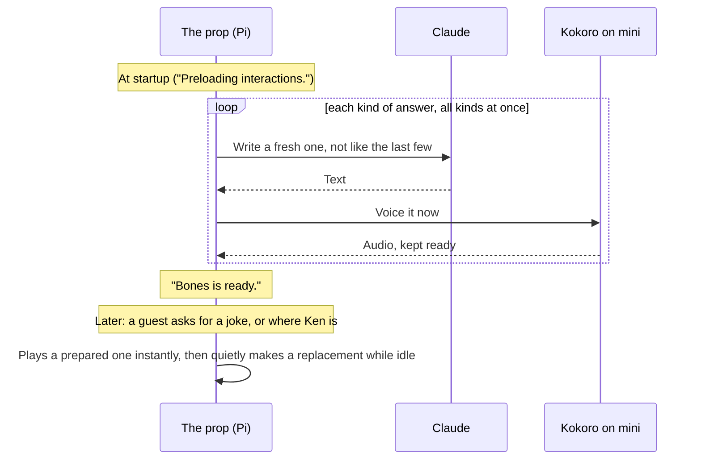

- Stocking up takes about **36 seconds** at startup.
- Each joke gets a random theme (pumpkins, vampires, Florida in October…), and
  Claude is shown the recent ones so it doesn't repeat itself.
- The bathroom, Ken and Amy answers are reworded from the facts in
  `persona.md`, and Claude is told not to add any of its own. "Where are Ken
  and Amy?", the question on the table sign, plays both answers back to back.
- "Ken" or "Amy" alone isn't enough to trigger a ready-made answer; it has to be
  a where-type question. A guest who says "I'm Ken" gets a live reply.
- Refills only happen while nobody is talking to Bones, so they never slow down
  a live conversation.

## 7. When something breaks

The prop is designed to keep talking, even if not as well.

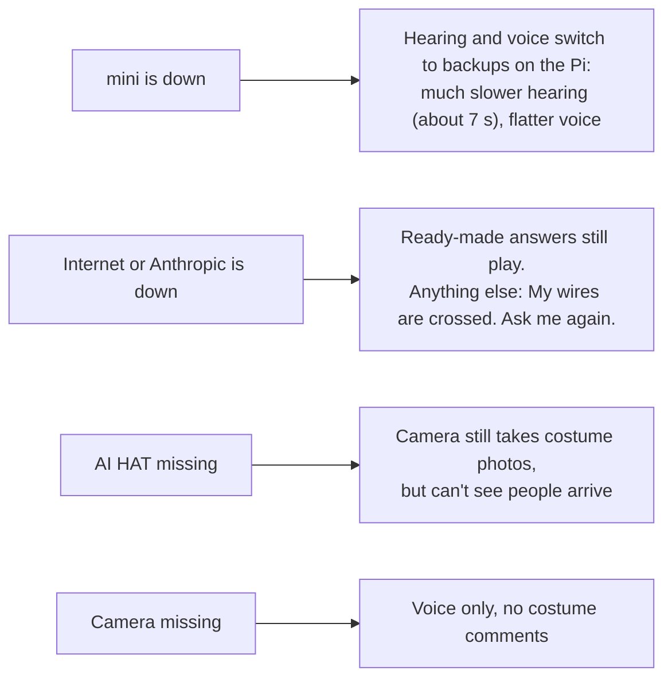

## Privacy: what leaves the house

| Information | Leaves the house? | Details |
|---|---|---|
| Sound from the microphone | **No** | Turned into text on mini |
| Background chatter while waiting for "Hello, Bones" | **No** | Transcribed on mini to check for the phrase. The text is written to the Pi's log file |
| What a guest says during a conversation | **Yes, to Anthropic** | As text, so Claude can reply |
| Video | **No** | Analysed on the AI HAT, on the prop |
| One still photo per reply | **Yes, to Anthropic** | 640×360, so Claude can see the costume. Only the newest photo is kept in the conversation |
| Web searches | **Run by Anthropic** | Our network never visits the sites |

What Anthropic does with the text and photos is covered by its terms for
business (API) customers. The logs on the Pi aren't sent anywhere, but they
are the one place where overheard snippets of conversation are kept. Clear them
after the party if that matters.

## What it costs

Only Claude costs money. Everything else runs on hardware we own.

- **Per reply:** about **$0.004** before web search was turned on, about
  **$0.01** since. With web search on, every call carries more instructions:
  about 4,500 units of text ("tokens") per call instead of 1,400.
- **So far:** **$0.48** for 131 replies, Oct 24–28. Preparing the ready-made
  answers adds a few cents each time the bot starts.
- **A busy party:** at 100 conversations of three or four replies each, roughly
  **$3–4** for the night. Web searches add a small per-search fee on top.

The bot logs a running total, so the cost is visible as the night goes on
(`make logs tag=CHAT`).

## Glossary

| Term | Meaning |
|---|---|
| **Model** | A trained AI program that does one kind of job (detect people, transcribe speech, write replies) |
| **Parameters** | The learned numbers inside a model; a rough measure of its size |
| **Speech-to-text (STT)** | Turning recorded speech into written words. Here: Whisper |
| **Text-to-speech (TTS)** | Turning written words into a spoken voice. Here: Kokoro |
| **AI HAT** | A plug-in board for the Raspberry Pi with a chip built for running AI models |
| **Wake phrase** | The words that make a device start listening ("Hello, Bones") |
| **Token** | The unit AI models read and write in, about three quarters of a word; what Anthropic charges by |
| **Streaming** | Using the start of a reply while the rest is still being written |
| **Latency** | The wait between a question and the first sound of the answer |
| **Persona** | The written description of Bones's character and rules, in `persona.md` |
